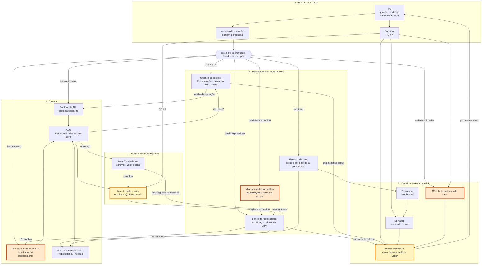
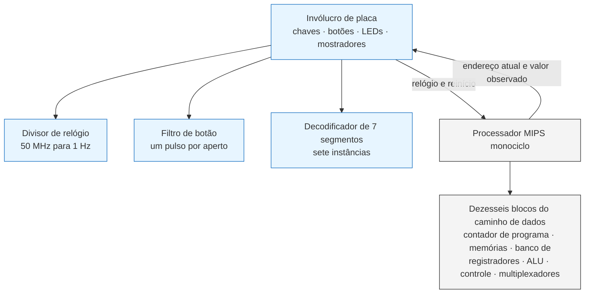

# Processador MIPS Monociclo com Jumps em Verilog

**Relatório da 2ª entrega parcial — 09/10/2026**

Ana Clara Eid Freire (22401684) · Jaide Fernando de Carvalho Zardin (22350981)
· Manuela Lopes Figueira (22400983)

Curso de Engenharia da Computação — Universidade Federal do Amazonas (UFAM)
Arquitetura de Sistemas Digitais e Laboratório

> **Rascunho de trabalho.** A versão final vai no template IEEE. Seções
> marcadas com *(pendente)* ainda não podem ser escritas com honestidade —
> preenchê-las antes de o resultado existir é o que faz um relatório técnico
> perder credibilidade na arguição.

---

## Resumo

Este relatório apresenta o estado da segunda entrega do projeto de
implementação de um processador MIPS em Verilog. O escopo desta etapa é o
caminho de dados monociclo completo, incluindo as instruções de salto
(`j`, `jal`, `jr`), com todos os componentes parametrizados e verificados por
testbench. São descritos o ambiente de desenvolvimento adotado, a arquitetura
do caminho de dados, os módulos implementados, a metodologia de verificação e
as pendências para o fechamento da etapa.

---

## I. Introdução e objetivos desta etapa

A primeira entrega estabeleceu o programa de teste: o procedimento de
ordenação por inserção (`sort`/`swap`) especificado pelo professor, traduzido
para assembly MIPS, codificado em binário por um montador desenvolvido pela
equipe e verificado por execução do binário gerado.

Esta segunda etapa implementa o **hardware que executa esse programa**: o
caminho de dados de um processador MIPS monociclo. Monociclo significa que
cada instrução é concluída em um único ciclo de clock — o sinal atravessa
todos os blocos combinacionais e, no fim do ciclo, o novo valor do PC e,
quando aplicável, o registrador destino ou a memória de dados são gravados.

A consequência dessa escolha é que o período do clock precisa acomodar o
caminho crítico, que é o da instrução `lw`: PC → memória de instruções →
banco de registradores → ALU → memória de dados → banco de registradores. É
exatamente essa limitação que o pipeline da terceira etapa virá resolver.

### Conjunto de instruções implementado

O caminho de dados suporta as doze instruções efetivamente usadas pelo
programa de teste:

| formato | instruções |
|---|---|
| R | `add`, `slt`, `sll`, `jr` |
| I | `addi`, `slti`, `lw`, `sw`, `beq`, `bne` |
| J | `j`, `jal` |

Delimitar o conjunto pelo programa real, em vez de implementar o MIPS
completo, mantém a unidade de controle em doze linhas e torna a verificação
exaustiva viável.

---

## II. Ambiente de desenvolvimento

A equipe trabalha em sistemas operacionais diferentes, o que motivou separar
o fluxo de **verificação** do fluxo de **síntese**:

| etapa | ferramenta | plataforma |
|---|---|---|
| escrita e simulação dos módulos | Icarus Verilog 13.0 | macOS, Linux e Windows |
| visualização de formas de onda | arquivos `.vcd` (GTKWave / Surfer) | qualquer |
| síntese e gravação na FPGA | Intel Quartus Prime *(versão pendente)* | Windows ou Linux |
| controle de versão | Git / GitHub | qualquer |
| gestão | Trello | — |

O Quartus Prime não é publicado para macOS, o que impede que integrantes em
Mac realizem síntese, atribuição de pinos ou gravação da FPGA. A decisão da
equipe foi: **todo o RTL é escrito e validado em simulação, em qualquer
sistema operacional, e apenas a síntese exige Quartus**, executada a partir
dos mesmos arquivos do repositório.

Comando único de verificação, a partir da raiz do repositório:

```bash
make
```

O Makefile descobre os módulos automaticamente: para cada `rtl/<nome>.v`
procura o testbench correspondente em `tb/`, compila, executa e reporta o
número de casos aprovados, encerrando com código de erro se algum falhar.

*(pendente: confirmar a versão exata do Quartus Prime instalada no
laboratório — exigência 1 da rubrica.)*

---

## III. Caminho de dados

### A. O que é um caminho de dados

Um processador não "interpreta" instruções uma por uma como um programa faria.
Ele é um circuito fixo, soldado no silício, por onde os dados **sempre**
passam pelos mesmos fios. O que muda de uma instrução para outra não é o
caminho existir — é **qual caminho é escolhido** em cada bifurcação.

As bifurcações são os multiplexadores, que aparecem repetidamente neste
relatório. Um multiplexador é uma chave: recebe várias entradas e um sinal de
seleção, e deixa passar apenas uma delas. Quem aciona essas chaves é a
unidade de controle, que lê a instrução e decide a posição de cada uma.

O conjunto de fios, somadores, memórias e multiplexadores chama-se **caminho
de dados**. A unidade de controle é o que o comanda.

Nesta implementação, **cada instrução é concluída em um único ciclo de
clock** — daí o nome monociclo. Durante o ciclo o sinal atravessa todo o
circuito; no fim dele, três coisas podem ser gravadas: o contador de
programa, um registrador e uma posição da memória de dados. Nada mais é
guardado, e é por isso que tudo precisa acontecer dentro do mesmo ciclo.

A consequência é que o período do clock precisa ser longo o bastante para a
instrução mais lenta, que é a de leitura da memória. Resolver esse desperdício
é justamente o objetivo do pipeline, assunto da terceira etapa.

### B. Os cinco passos de uma instrução

Mesmo sem estágios separados, toda instrução percorre a mesma sequência
lógica dentro do ciclo:

1. **Buscar** — o contador de programa aponta um endereço, e a memória de
   instruções devolve os 32 bits que estão lá.
2. **Decodificar e ler** — esses 32 bits são fatiados em campos. Alguns dizem
   o que fazer, outros dizem quais registradores usar, outros carregam uma
   constante. Os registradores indicados são lidos.
3. **Calcular** — a unidade lógica e aritmética (ALU) opera sobre dois
   valores. Dependendo da instrução, ela soma números do programa, calcula um
   endereço de memória ou compara dois valores.
4. **Acessar a memória** — apenas as instruções de leitura e escrita usam
   este passo; as demais o atravessam sem efeito.
5. **Gravar** — o resultado volta para um registrador, e o contador de
   programa recebe o endereço da próxima instrução.

Um detalhe que costuma surpreender: **os cinco passos não são sequenciais no
tempo**. Todos os blocos estão ligados e trabalhando simultaneamente durante
o ciclo inteiro. A memória de dados recebe um endereço mesmo numa instrução
de soma — simplesmente ninguém usa o que ela responde. Hardware não escolhe o
que calcular; ele calcula tudo e descarta o que não serve.

### C. O caminho de dados implementado

O ponto de partida é a organização clássica descrita em [1], seções 4.3 e
4.4. Sobre ela, cinco pontos precisaram ser acrescentados ou ampliados para
que as instruções de salto do programa de teste funcionassem. No diagrama
abaixo, os blocos em **laranja escuro** são acréscimos que não existem no
caminho de dados básico, e os em **amarelo** são blocos que existem, mas
tiveram que ser ampliados.



### D. Por que cada acréscimo foi necessário

A regra que orientou cada decisão foi sempre a mesma: *qual instrução do
programa de teste deixaria de funcionar sem este bloco?* Nada foi acrescentado
por completude teórica.

#### 1. O multiplexador que escolhe o registrador destino

**O que faz.** Decide qual dos 32 registradores vai receber o valor gravado
no fim do ciclo.

**Por que foi necessário.** O número do registrador destino não está sempre no
mesmo lugar da instrução. Nas instruções que operam entre registradores, ele
está num campo; nas que usam uma constante, está em outro; e na instrução de
chamada de função ele não está em campo nenhum — é sempre o registrador 31,
por convenção do MIPS. São três origens diferentes para a mesma informação,
e é preciso escolher entre elas.

**O que quebraria sem ele.** A instrução `addi $sp, $sp, -20`, do prólogo da
função de ordenação, gravaria o resultado no registrador errado. A pilha
nunca seria reservada e o programa se perderia na primeira chamada.

#### 2. O multiplexador da primeira entrada da ALU

**O que faz.** Escolhe se a primeira entrada da ALU vem de um registrador ou
do campo de deslocamento embutido na própria instrução.

**Por que foi necessário.** A instrução de deslocamento à esquerda precisa
saber *quantas casas* deslocar, e essa quantidade é uma constante pequena
escrita dentro da instrução — não o conteúdo de um registrador. No caminho de
dados básico, a primeira entrada da ALU vem sempre do banco de registradores,
sem alternativa.

**O que quebraria sem ele.** A instrução `sll $t1, $a1, 2`, que multiplica o
índice por 4 para calcular a posição de um elemento do vetor, deslocaria pela
quantidade errada. Todos os endereços de vetor sairiam incorretos e o programa
ordenaria lixo — sem gerar erro algum, o que é o pior tipo de defeito.

#### 3. O bloco que monta o endereço de salto

**O que faz.** Constrói o endereço de destino das instruções de salto
incondicional a partir dos 26 bits reservados para isso na instrução.

**Por que foi necessário.** Desvio condicional e salto resolvem problemas
diferentes. O desvio condicional guarda uma distância *relativa*, pequena,
suficiente para pular algumas instruções dentro de um laço. O salto precisa
alcançar qualquer ponto do programa, então guarda um endereço *absoluto*.
Como 26 bits não preenchem os 32 de um endereço, os quatro bits mais altos
são herdados do endereço atual e os dois mais baixos são sempre zero, porque
toda instrução está alinhada em quatro bytes.

**O que quebraria sem ele.** Não existiriam `j` nem `jal`. Sem `jal` não
existe chamada de função; sem chamada de função, a rotina de ordenação não
consegue invocar a rotina de troca. O programa de teste inteiro é impossível.

#### 4. O multiplexador do próximo endereço, ampliado de duas para quatro entradas

**O que faz.** Escolhe de onde vem o endereço da próxima instrução.

**Por que foi necessário.** No caminho de dados básico há apenas duas
possibilidades: seguir em frente, ou desviar. O programa de teste precisa de
quatro:

| situação | de onde vem o próximo endereço |
|---|---|
| execução normal | do somador que calcula o endereço seguinte |
| desvio condicional tomado | do somador do desvio |
| salto incondicional | do bloco que monta o endereço de salto |
| **retorno de função** | **do banco de registradores** |

A quarta é a mais interessante: o endereço de retorno não está na instrução
nem foi calculado — está guardado num registrador, colocado lá pela chamada
que ocorreu antes. É a única situação em que um valor lido do banco de
registradores vai parar diretamente no contador de programa.

**O que quebraria sem ele.** A rotina de troca nunca voltaria para quem a
chamou. O processador entraria em laço infinito na primeira chamada.

#### 5. O multiplexador do dado gravado, ampliado de duas para três entradas

**O que faz.** Escolhe qual valor é gravado no registrador destino.

**Por que foi necessário.** No caminho de dados básico há duas origens: o
resultado da ALU, ou o valor lido da memória. A instrução de chamada de função
precisa de uma terceira — ela grava **o endereço da instrução seguinte**, para
que a função saiba para onde voltar.

**O que quebraria sem ele.** A chamada de função saltaria corretamente, mas
não deixaria rastro de onde voltar. O retorno levaria o programa a um endereço
indefinido.

#### Um sinal que foi removido

O caminho de dados do livro traz um sinal de habilitação de leitura da memória
de dados. Nesta implementação ele não existe: a leitura é contínua e sem
efeito colateral, de modo que ler um endereço cujo valor ninguém usa não causa
problema. Remover o sinal simplifica a unidade de controle sem alterar o
comportamento. A escrita, essa sim, continua controlada — gravar por engano
corromperia a memória.

### E. A interface entre o controle e o caminho de dados

Cada multiplexador descrito acima recebe um sinal de seleção, e cada sinal tem
uma codificação própria: qual valor corresponde a qual entrada. Essas
codificações estão registradas em [`docs/contrato-sinais.md`](contrato-sinais.md),
com a tabela completa das doze instruções.

Esse documento existe porque a discordância entre a unidade de controle e os
multiplexadores é o único erro do projeto que **nenhum teste de bloco isolado
consegue detectar**: cada peça, verificada sozinha, está correta; o defeito só
aparece quando tudo é ligado.

### F. Mapeamento entre a arquitetura e os arquivos

Os nomes usados acima são descritivos, para que o texto seja legível por quem
não conhece o código. A correspondência com os arquivos do repositório é a
seguinte.

**Caminho de dados — `rtl/`**

| arquivo | papel na arquitetura |
|---|---|
| `pc.v` | contador de programa: guarda o endereço da instrução atual |
| `somador.v` | soma dois valores; usado em duas instâncias — `PC + 4` e destino do desvio |
| `memoria_instrucoes.v` | memória somente-leitura que contém o programa |
| `banco_registradores.v` | os 32 registradores; duas leituras e uma escrita por ciclo |
| `extensor_sinal.v` | estica a constante de 16 para 32 bits preservando o sinal |
| `memoria_dados.v` | variáveis, vetor de teste e pilha |
| `alu.v` | unidade lógica e aritmética; produz também o sinal de igualdade |
| `alu_control.v` | traduz a família da operação e o campo da instrução na operação exata |
| `control_unit.v` | unidade de controle: lê a instrução e aciona todos os multiplexadores |
| `shift_left_2.v` | multiplica por quatro o deslocamento do desvio |
| `mux_alu_a.v` | **(acréscimo 2)** primeira entrada da ALU: registrador ou deslocamento |
| `mux_alu_b.v` | segunda entrada da ALU: registrador ou constante |
| `mux_write_reg.v` | **(acréscimo 1)** qual registrador recebe a escrita |
| `mux_write_data.v` | **(acréscimo 5)** qual valor é gravado no registrador |
| `jump_address_calc.v` | **(acréscimo 3)** monta o endereço do salto incondicional |
| `mux_pc.v` | **(acréscimo 4)** de onde vem o endereço da próxima instrução |
| `mips_monociclo.v` | topo do processador: instancia os dezesseis blocos acima e liga a fiação |

**Invólucro de placa — `fpga/`**

Nada aqui faz parte do processador; são as peças que existem apenas para
mostrar o resultado numa placa física.

| arquivo | papel |
|---|---|
| `de2_115_top.v` | liga o processador às chaves, botões, LEDs e mostradores |
| `divisor_clock.v` | reduz os 50 MHz da placa para cerca de 1 Hz, tornando a execução visível |
| `botao_pulso.v` | filtra o repique mecânico do botão e gera um único pulso por aperto |
| `decodificador_7seg.v` | converte um dígito hexadecimal no padrão de segmentos do mostrador |

A separação é deliberada: o processador recebe apenas sinal de relógio,
sinal de reinício e portas de observação. Ele não sabe que existe uma
DE2-115, o que permite simulá-lo, trocar de placa ou mudar o esquema de
mostradores sem alterar uma linha do caminho de dados.



O diagrama acima mostra a contenção: tudo que é azul desaparece se o projeto
for simulado em vez de embarcado, e o processador continua idêntico.

## IV. Módulos implementados

| módulo | função | tipo | testbench |
|---|---|---|---|
| `pc` | registrador do contador de programa | sequencial | 10 casos |
| `somador` | soma de dois valores; usado em PC+4 e no destino de desvio | combinacional | 9 casos |
| `memoria_instrucoes` | ROM do programa; carrega `mem/programa.txt` | combinacional | 6 casos |
| `banco_registradores` | 32 registradores, duas leituras e uma escrita | misto | 9 casos |
| `extensor_sinal` | estende o imediato de 16 para 32 bits com sinal | combinacional | 12 casos |
| `memoria_dados` | leitura e escrita de palavras, para `lw` e `sw` | misto | 11 casos |
| `mux_alu_b` | seleciona registrador ou imediato na entrada B da ALU | combinacional | 6 casos |
| `mux_alu_a` | seleciona registrador ou `shamt` na entrada A | combinacional | conferência visual |
| `mux_pc` | seleciona PC+4, desvio, salto ou `jr` | combinacional | conferência visual |
| `mux_write_reg` | seleciona `rt`, `rd` ou `$ra` como destino | combinacional | conferência visual |
| `mux_write_data` | seleciona ALU, memória ou PC+4 como dado escrito | combinacional | conferência visual |
| `jump_address_calc` | monta o endereço de salto do formato J | combinacional | conferência visual |
| `alu` | operações aritméticas e lógicas; gera o sinal `zero` | combinacional | 15 casos |
| `alu_control` | decodifica `alu_op` + `funct` na operação da ALU | combinacional | 10 casos |
| `control_unit` | emite todos os sinais de controle a partir do opcode | combinacional | 15 casos |
| `shift_left_2` | multiplica por 4 o imediato do desvio | combinacional | 6 casos |
| **`mips_monociclo`** | **top-level: instancia os dezesseis blocos e liga a fiação** | — | **12 casos** |

### Decisões de projeto que valem registro

**Leitura combinacional, escrita sequencial.** No banco de registradores e na
memória de dados, a leitura não espera borda de clock — o dado precisa estar
disponível ainda dentro do ciclo para a ALU usar. A escrita só ocorre na
subida do clock. Essa assimetria é o que torna o monociclo possível.

**O registrador `$zero` é fiação, não convenção.** A leitura do endereço 0
devolve zero e a escrita no endereço 0 é descartada, por construção. O
programa de teste depende disso: `addi $s0, $zero, 0` e `add $s3, $a0, $zero`
só funcionam porque o hardware garante o valor.

**Profundidade da memória de dados: 256 palavras.** O valor não é arbitrário.
Simulando o binário do programa e registrando todos os endereços de dados
acessados, o maior é 1020, correspondente à palavra 255. O `$sp` inicia em
1024, a pilha ocupa as palavras 251 a 255 e o vetor de teste ocupa 0 a 7,
restando 243 palavras livres entre eles. Memória menor faria a pilha colidir
com o vetor, corrompendo a ordenação sem gerar erro algum.

**Somador separado da ALU.** No monociclo, o cálculo de PC+4, o cálculo do
destino de desvio e a operação da instrução ocorrem no mesmo ciclo. Não é
possível reaproveitar a ALU para os três, o que justifica as duas instâncias
do módulo `somador`.

---

## V. Metodologia de verificação

Cada módulo possui um testbench próprio em `tb/`, que instancia o módulo,
aplica estímulos e compara as saídas com valores esperados, reportando
aprovação ou falha caso a caso.

Duas escolhas metodológicas:

**Os estímulos vêm do programa real.** Os casos de teste não são valores
arbitrários. O testbench do `extensor_sinal` verifica o imediato `-20` do
`addi $sp, $sp, -20`; o do `somador` verifica o destino `140` do
`beq $t0, $zero, exit1` que está no endereço 72; o da `memoria_instrucoes`
compara contra os binários gerados pelo montador da própria equipe. Verificar
contra o programa que o processador vai executar expõe erros que um teste
genérico não alcançaria.

**Os casos incluem as bordas.** O `extensor_sinal` é testado em `0x7FFF` e
`0x8000` — um bit de diferença na entrada que inverte os dezesseis bits
superiores da saída. O `banco_registradores` é testado gravando em `$zero`
para confirmar que a escrita é descartada.

Estado atual da verificação:

```
17 módulos com testbench, 121 casos, todos aprovados
```

Cinco testbenches — os dos multiplexadores e do `jump_address_calc` — imprimem
valor esperado e obtido lado a lado para conferência visual, sem contagem
automática de erros. O Makefile os marca com `ok*` para distinguir dos que se
auto-verificam.

---

## VI. Parametrização

Todos os módulos são parametrizados: nenhuma largura literal aparece no corpo
dos blocos. As larguras derivam de `parameter` declarados no cabeçalho
(`LARGURA`, `DATA_WIDTH`, `N_REGS`, `PROFUNDIDADE`, `SHAMT_WIDTH`).

Quando aplicável, os testbenches instanciam o **mesmo módulo duas vezes com
larguras diferentes**, demonstrando que o parâmetro controla efetivamente o
hardware gerado e não é apenas declarativo. O testbench do `extensor_sinal`
verifica as configurações 16→32 e 8→32; o do `somador`, 32 e 16 bits; o do
`pc`, 32 bits com início em 0 e 16 bits com início em `0x0100`.

Uma exceção conhecida: em `jump_address_calc`, os valores `4` e `2` da
concatenação são fixos, embora `TARGET_WIDTH` seja parâmetro. Os três valores
não são independentes — decorrem da definição do formato J do MIPS — e a
documentação do módulo deve registrar isso.

---

## VII. Estado atual e pendências

**Concluído:** dezessete módulos implementados, incluindo o top-level; todos
com testbench aprovado, somando 121 casos; contrato de sinais de controle
documentado e verificado instrução a instrução; processador completo
executando o programa de ordenação corretamente em simulação; ambiente de
simulação funcionando nas três máquinas da equipe.

**Pendente:**

| item | responsável | rubrica |
|---|---|---|
| Projeto Quartus, versão confirmada e síntese na DE2-115 | C | 1 |
| Vídeo da apresentação no YouTube | equipe | 5 |
| Converter os cinco testbenches de conferência visual em auto-verificáveis | C | 3 |

## VIII. Resultados

O processador completo foi integrado e executa o programa de ordenação em
simulação. O testbench `tb/mips_monociclo_tb.v` carrega `mem/programa.txt` na
memória de instruções, libera o reset e deixa o processador executar até
parar sozinho no laço `j end`, conferindo em seguida o conteúdo da memória de
dados.

```
== processador completo executando mem/programa.txt ==
   vetor inicial : 5 3 8 1 9 2 7 4
  ok    reset: PC = 0
  ok    parou no halt depois de 406 ciclos, PC = 248
   vetor final   : 1 2 3 4 5 7 8 9
   esperado      : 1 2 3 4 5 7 8 9
  ok    $sp restaurado em 1024 ao final do sort
  ok    $zero permanece 0
RESULTADO: todos os casos passaram
```

Três observações sobre o resultado:

**O vetor é ordenado corretamente**, satisfazendo o critério objetivo de
sucesso definido no relatório da primeira entrega.

**A contagem de ciclos confere com a previsão.** Antes de o hardware existir,
o binário gerado pelo montador foi executado por um interpretador que
reproduz o ciclo de busca-decodificação-execução, resultando em 404
instruções. O processador em Verilog parou em 406 ciclos — as duas unidades
adicionais correspondem ao ciclo de reset e ao ciclo em que a repetição do PC
é detectada. A coincidência entre as duas contagens, obtidas por caminhos
independentes, é evidência forte de que o caminho de dados executa exatamente
o programa especificado.

**O estado da máquina ao final está consistente.** O `$sp` retorna a 1024,
confirmando que o epílogo de `sort()` restaurou a pilha corretamente, e o
`$zero` permanece nulo, confirmando que a proteção por hardware do registrador
0 resistiu a todas as instruções executadas.

A verificação do processador completo é qualitativamente diferente da
verificação dos módulos isolados: os testbenches de módulo provam que cada
peça funciona sozinha, enquanto este prova que a **fiação entre elas** está
correta. Um único sinal trocado no top-level produziria um vetor desordenado,
mesmo com todos os módulos individualmente aprovados.

---

## Referências

[1] D. A. Patterson e J. L. Hennessy, *Computer Organization and Design — The
Hardware/Software Interface*, 4ª edição revisada. Morgan Kaufmann / Academic
Press, 2012. Capítulo 4, seções 4.1 a 4.4.
